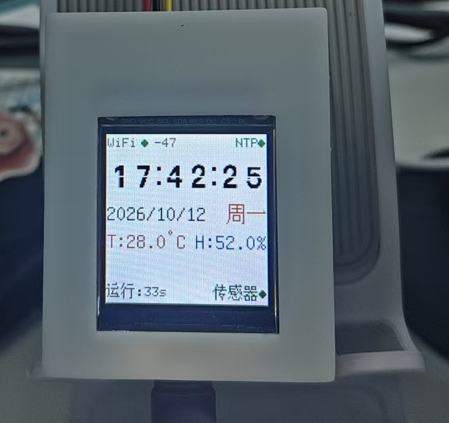

# Weather Clock - ESP32-C3 ST7735 温湿度时钟

基于 ESP32-C3 和 ST7735 1.44" 128×128 TFT 显示屏的温湿度时钟项目，带翻页时钟动画、Web 配置界面、图表页面、系统信息页面和 MQTT 远程发布功能。三个页面由 TP223 触摸按键循环切换。

## 功能特性

### 显示
- **翻页时钟动画**：首页时间采用翻页动画（20 FPS），显示完整的 HH:MM:SS
- **农历与节气**：日期下方左侧显示农历（如「八月十三」），右侧显示当日节气（如「霜降」）；当天不是节气日则显示下一个节气及日期（如「立冬 11/7」，跨年自动取次年小寒）。纯离线计算，农历年表覆盖 1900–2099
- **触摸翻页**：TP223 电容触摸按键（GPIO10），每次触摸切换到下一页；页面由 `kPages[]` 页面表驱动，可扩展多页
- **系统信息页面**：显示芯片修订/CPU/Flash/内存/芯片温度/RSSI/IP/DHT11/触摸计数；每行按内容缓存，值未变化不重绘，避免闪烁
- **温湿度图表**：单图表双 Y 轴绘制温度（红）与湿度（蓝）曲线，时间坐标轴 0~127 占满图表框宽度，温度范围/湿度范围标签紧贴框内边缘
- **背景色擦除**：传感器行采用"上次文本背景色覆盖"的双缓冲，避免数值位数变化时残留字尾
- **背光亮度控制**：0-100% PWM 调光
- **RSSI 信号强度**：状态栏实时显示 WiFi 信号
- **WiFi/IP 显示切换**：状态栏每 5 秒在 IP 地址与 RSSI 之间切换

### 传感器
- **DHT11 ×1**：GPIO7
- **历史数据存储**：按日期保存到 LittleFS `/sensor1_YYYY-MM-DD.dat`
- **自动清理**：保留最近 7 天数据，自动删除更早的文件
- **降噪处理**：阈值抑制 DHT11 抖动噪声，连续失败时复用上一次有效值

### 通信
- **WiFi 配网**：AP 模式 + ESP-Touch SmartConfig，首次连接失败自动开启热点
- **NTP 时间同步**：从阿里云 NTP 服务器同步时间
- **MQTT 远程发布**：
  - 变化驱动：温度变化 ≥0.5°C 或湿度变化 ≥1.0% 时立即推送
  - 保活推送：每 60 秒强制推送一次
  - 节流：最小 5 秒间隔，避免频繁推送
  - Home Assistant 自动发现：连接成功后自动注册
  - **支持认证**：用户名/密码登录
- **Web 配置界面**：
  - `http://<设备IP>/` 实时数据 + 历史图表
  - 日期下拉框：可查看任意历史日期的数据
  - REST API：`/api/current`、`/api/history`、`/api/dates`

## 硬件配置

### 引脚定义

| 引脚 | 功能 |
|------|------|
| GPIO0 | TFT CS |
| GPIO1 | TFT DC |
| GPIO2 | TFT RST |
| GPIO3 | TFT MOSI |
| GPIO4 | TFT SCLK |
| GPIO5 | TFT BL（背光）|
| GPIO7 | DHT11（温湿度）|
| GPIO8 | 板载 LED |
| GPIO10 | TP223 触摸按键（推挽输出，按下为高电平）|

### 屏幕参数

- 型号：ST7735S
- 分辨率：128×128
- 接口：SPI @ 40MHz

## 页面布局

### 页面 0：时钟页面

```
┌────────────────────────────────┐
│ WiFi● -65      NTP●            │ ← 状态栏 (WiFi状态+RSSI / NTP状态，每 5s 切换为 IP)
├────────────────────────────────┤
│          14:30:56              │ ← 翻页时钟 (HH:MM:SS 翻页动画，20 FPS)
├────────────────────────────────┤
│ 2026/07/14           周一      │ ← 日期卡片 (年/月/日 | 星期)
├────────────────────────────────┤
│ 八月十三          立冬 11/7    │ ← 农历行 (左：农历 | 右：当日节气或下一节气+日期)
├────────────────────────────────┤
│ T:26.5°C   │    65.0% H        │ ← 传感器行 (温度红 / 湿度蓝，紧贴左右框边)
├────────────────────────────────┤
│ 运行:2h30m           传感器●   │ ← 底部状态 (运行时间 / 传感器状态)
└────────────────────────────────┘
```



### 页面 1：图表页面

```
┌────────────────────────────────┐
│ T:26.5C          H:65.0%       │ ← 标签栏 (当前温度红色 / 当前湿度蓝色)
├────────────────────────────────┤
│┌─────────────────────────────┐ │
││50─                         100│ │ ← 图表框
││                              │ │   左轴：温度范围 (°C，红色，紧贴左边)
││  ╭──╮    ╭──╮               │ │   右轴：湿度范围 (% ，蓝色，紧贴右边)
││40─╯  ╰──╮╰  ╰──╮  ╭──╮    ──80│ │   温度曲线：红
││         ╰──╯   ╰──╯  ╰──╯     │ │   湿度曲线：蓝 (0~100% 映射到温度 Y 轴)
││30─                          ──60│ │
││                              │ │   时间坐标轴：0~127 占满整个图表宽度
││20─                          ──40│ │   刻度：00/04/08/12/16/20/24
││                              │ │   当前时间游标：绿
││10─                          ──20│ │
│└─────────────────────────────┘ │
├────────────────────────────────┤
│ 00  04  08  12  16  20   现在  │ ← 时间刻度 (贴图表外，靠边对齐)
├────────────────────────────────┤
│            14:30                │ ← 底部时间 (HH:MM)
└────────────────────────────────┘
```

### 页面 2：系统信息页面

```
┌────────────────────────────────┐
│ ESP32-C3           160MHz r4   │ ← 标题 (芯片标识 / 实测 CPU 频率 + 芯片修订号)
├────────────────────────────────┤
│ Uptime:  02d 03:45:12          │ ← 运行时间 (天 时:分:秒)
│ Heap:    250K / min 246K        │ ← 内存 (当前空闲 / 历史最低空闲)
│ Flash:   4MB  80MHz             │ ← Flash (容量 / 速率，均实测)
│ Temp:    42°C      RSSI -58dBm  │ ← 芯片内部温度 / WiFi 信号强度
│ IP:      192.168.1.100          │ ← 本机 IP
├────────────────────────────────┤
│ DHT11:   25.3°C    48.0%RH      │ ← 环境温湿度 (温度红 / 湿度蓝)
│ TTP223:  12次                   │ ← 触摸累计次数
└────────────────────────────────┘
```

布局为 8 行（标题 + 7 内容），行距 15px。数据来源：

| 行 | 数据来源 |
|----|----------|
| 标题 | `getCpuFrequencyMhz()` + `ESP.getChipRevision()`（实测值）|
| Uptime | `millis()` 换算 天/时/分/秒 |
| Heap | `ESP.getFreeHeap()` / `ESP.getMinFreeHeap()` |
| Flash | `ESP.getFlashChipSize()` / `ESP.getFlashChipSpeed()` |
| Temp | `temperatureRead()`（芯片内部温度传感器）|
| RSSI | `WiFi.RSSI()`，未连接时显示 `--` |
| IP | `WiFiManager` 当前 IP，未连接时显示 `--` |
| DHT11 | `getSensorSnapshot()`（温度红 / 湿度蓝）|
| TTP223 | `g_touchCount`（`main.cpp` 在每次触摸时自增）|

> **关于标称值**：本页的 Flash 容量、CPU 频率、芯片修订号均为运行时实测。ESP32-C3 堆区实测约 272KB（`ESP.getHeapSize()`），板级定义中的 `maximum_ram_size = 327680`（320KB）是链接脚本标称值，二者不等价，故本页不使用 320KB 这一数字。

## 页面表（扩展新页面）

页面不再写死在 loop 里，而是登记在 `main.cpp` 的 `kPages[]` 中，每项包含 4 个回调：

```cpp
struct PageDef {
    void (*init)();     // 初始化（setup 阶段调用一次）
    void (*draw)();     // 整页重绘
    void (*update)();   // 每秒刷新
    void (*animate)();  // 高频动画（20 FPS），无则填 nullptr
};

static const PageDef kPages[] = {
    { initClockPage, drawClockPage, updateClockPage, renderFlipClockWidgetAnimation },
    { initChartPage, drawChartPage, updateChartPage, nullptr },
    { initSysInfoPage, drawSysInfoPage, updateSysInfoPage, nullptr },
};
static const int PAGE_COUNT = sizeof(kPages) / sizeof(kPages[0]);
```

- 数组顺序 = 触摸切换顺序，页面数量由 `PAGE_COUNT` 自动推导
- 切换使用 `if (++currentPage >= PAGE_COUNT) currentPage = 0;`（不使用取模）
- setup 阶段遍历调用所有页面的 `init()`；loop 中按当前页分发 `draw`/`update`/`animate`，无需 `if (currentPage == …)` 分支
- 新增页面：实现该页的 `init/draw/update`（`animate` 可选），在 `kPages` 末尾追加一行即可

## 项目结构

```
src/
├── Display.h          # LovyanGFX 显示类定义
├── Display.cpp        # 显示工具函数 (drawBg, clearRect)
├── ClockPage.h        # 时钟页面声明
├── ClockPage.cpp      # 时钟页面绘制逻辑（双缓冲擦除传感器行）
├── cal_almanac.h      # 农历/24 节气/节日接口（纯 C99，离线计算）
├── cal_almanac.c      # 农历换算、Meeus 节气求解、节日表
├── cal_lunar_table.h  # 1900–2099 农历年表声明
├── cal_lunar_table.c  # 农历年表数据（自动生成，勿手改）
├── FlipClockPage.h    # 翻页时钟声明
├── FlipClockPage.cpp  # 翻页时钟动画实现（20 FPS）
├── ChartPage.h        # 图表页面声明
├── ChartPage.cpp      # 图表页面绘制（sprite 双缓冲，时间轴 0~127 占满）
├── SysInfoPage.h      # 系统信息页面声明
├── SysInfoPage.cpp    # 系统信息页面绘制（逐行缓存，仅变化行重绘）
├── SensorHistory.h    # 传感器历史数据类
├── SensorHistory.cpp  # 传感器数据存储与文件读写
├── SensorWebServer.h  # Web 服务器声明
├── SensorWebServer.cpp# HTTP API + Web UI
├── WiFiManager.h      # WiFi 管理类声明
├── WiFiManager.cpp    # WiFi 连接、AP 模式、SmartConfig
├── MqttManager.h      # MQTT 管理类声明
├── MqttManager.cpp    # MQTT 状态机（PubSubClient）
├── DHT11Sensor.h      # DHT11 传感器类声明
├── DHT11Sensor.cpp    # DHT11 传感器驱动（位操作时序）
├── SharedState.h      # 跨任务共享数据结构 + 互斥锁（含 SharedTimeInfo）
├── SharedState.cpp    # 共享状态实现
├── TaskManager.h      # FreeRTOS 任务管理
├── TaskManager.cpp    # 5 个任务：WiFi/NTP/Sample/MQTT/Web + UI
├── digitals.h         # 翻页时钟数字位图数据
├── Log.h              # 全局日志宏 (LOG_T/LOG_LN)
└── main.cpp           # 主程序入口（Setup / Loop 触摸翻页 + 页面表 kPages）
```

## 使用说明

### 首次启动

1. 烧录固件到 ESP32-C3
2. 首次连接 WiFi 失败时，设备自动创建热点 `ESP32-Weather`（开放网络，无密码）
3. 用手机连接该热点
4. 在浏览器打开 `192.168.4.1` 配置 WiFi 网络
5. 配置成功后设备自动重启并连接 WiFi

### Web 界面

设备连上 WiFi 后：
1. 串口监视器会打印 IP 地址
2. 浏览器访问 `http://<IP>/`
3. 主页面显示当前传感器读数
4. 点击"图表"标签可查看历史曲线
5. **日期下拉框**：选择任意历史日期查看当天数据

#### REST API

| 路径 | 说明 |
|------|------|
| `GET /` | Web 主页面 |
| `GET /api/current` | 当前传感器数据（JSON）|
| `GET /api/history?type=temp&days=1` | 历史数据（`type`: temp/hum，`days`: 1）|
| `GET /api/dates` | 可用历史日期列表 |

### MQTT 集成

配置 `main.cpp` 中的 `MQTT_SERVER` / `MQTT_PORT` / `MQTT_USER` / `MQTT_PASS`：

```cpp
#define MQTT_SERVER   "mqtt.covid.ccwu.cc"
#define MQTT_PORT     1883
#define MQTT_USER     "admin"
#define MQTT_PASS     "lwei2HRTINQz"
```

发布到的主题：

| 主题 | 内容 | QoS | Retained |
|------|------|-----|----------|
| `esp32/sensor/temp` | 温度（float）| 0 | ✅ |
| `esp32/sensor/hum`  | 湿度（float）| 0 | ✅ |
| `homeassistant/sensor/esp32_*/config` | HA 自动发现（连接时发）| 0 | ✅ |

### 调试日志

所有日志自动带 `[HH:MM:SS.mmm]` 时间戳（uptime），方便对照事件时序：

```
[00:00:05.123] [WiFi] 已连接: Chinanet-CMCC-01, IP: 10.45.1.13
[00:00:05.234] [MQTT] 初始化服务器: mqtt.covid.ccwu.cc:1883
[00:00:05.235] [MQTT] 启用认证: user=admin
[00:00:05.236] [MQTT] 状态切换: IDLE -> CONNECTING
[00:00:05.567] [MQTT] ✅ 连接成功
[00:00:05.678] [TaskMQTT] 连接成功，发送发现消息
```

## 编译与上传

### 编译

```bash
platformio run
```

或使用批处理文件：

```bash
.\build.bat
```

### 上传

```bash
platformio run --target upload
```

### 串口监控

```bash
.\monitor.bat
```

## 配置参数

在 `main.cpp` 中可修改以下配置：

| 参数 | 默认值 | 说明 |
|------|--------|------|
| `BACKLIGHT_PERCENT` | 80 | 背光亮度百分比（0-100）|
| `PIN_TOUCH` | 10 | TP223 触摸按键引脚 |
| `TOUCH_DEBOUNCE_MS` | 50 | 触摸去抖间隔（毫秒）|
| `SENSOR_PERIOD_MS` | 5000 | 传感器采样间隔（毫秒）|
| `WIFI_CHECK_INTERVAL` | 5000 | WiFi 检查间隔（毫秒）|
| `MQTT_FORCE_PUBLISH_INTERVAL` | 60000 | MQTT 保活推送间隔（毫秒）|
| `MQTT_MIN_PUBLISH_INTERVAL` | 5000 | MQTT 最小推送间隔（毫秒）|
| `MQTT_TEMP_DELTA` | 0.5 | 温度变化阈值（°C）|
| `MQTT_HUM_DELTA` | 1.0 | 湿度变化阈值（%）|

## 依赖库

| 库 | 版本 | 用途 |
|----|------|------|
| LovyanGFX | 1.2.21 | TFT 显示驱动 |
| DHT sensor library | 1.4.7 | 温湿度传感器 |
| PubSubClient | 2.8+ | MQTT 客户端（**已从 AsyncMqttClient 迁移**）|
| WebServer | 2.0.0 | HTTP Web 服务 |
| LittleFS | 2.0.0 | 历史数据存储 |
| WiFi | 2.0.0 | 网络连接 |
| Preferences | 2.0.0 | NVS 凭据存储 |

> **变更说明**：原项目使用 `AsyncMqttClient`，因 ESP32-C3 上 AsyncTCP 兼容性问题（TCP 探针通过但 MQTT 握手失败）已迁移至 `PubSubClient`（基于同步 WiFiClient）。稳定性大幅提升。

## 架构

### 任务划分（FreeRTOS）

| 任务 | 周期 | 职责 |
|------|------|------|
| `taskWiFi` | 50ms | WiFi 连接维护、AP 模式、SmartConfig |
| `taskNTP` | 1s/24h | NTP 同步 |
| `taskSample` | 5s | 读取 DHT11、写入历史、推送到 MQTT |
| `taskMQTT` | 50ms | MQTT 状态机轮询、发布节流控制 |
| `taskWeb` | 5s | Web 服务器处理客户端请求 |
| `taskDisplay` | 主循环 | 触摸翻页调度、翻页动画、各页面重绘（时钟/图表/系统信息）|

### 数据流

```
DHT11 (5s)  →  SharedState  ←  MQTT
                  ↓                ↑
           TaskDisplay         TaskMQTT
                  ↓
              ST7735

      SensorHistory ←→ LittleFS
                  ↓
            SensorWebServer → Web UI
```

## 故障排查

### MQTT 反复断开
- 检查服务器 IP / 端口 / 用户名 / 密码
- 串口日志中 `state=` 字段会显示 PubSubClient 错误码
- WiFi 信号弱也会导致连接不稳定

### 图表页闪烁
- 已通过 sprite 双缓冲修复
- 若仍闪烁，串口日志会提示 sprite 创建失败（内存不足）

### 传感器行残留字尾
- 已通过"上次文本 + 背景色覆盖"的双缓冲修复
- 若仍有残影，确认 `ClockPage.cpp` 中的 `lastBuf1/lastBuf2` 已正确初始化

### WiFi 连接失败
- 设备会自动开启 AP 热点
- 用手机连接 `ESP32-Weather`（开放网络，无密码）配置

### 时间不准
- NTP 同步成功后会自动校准
- 检查 WiFi 路由器是否允许 NTP 出站

## 许可证

MIT License
